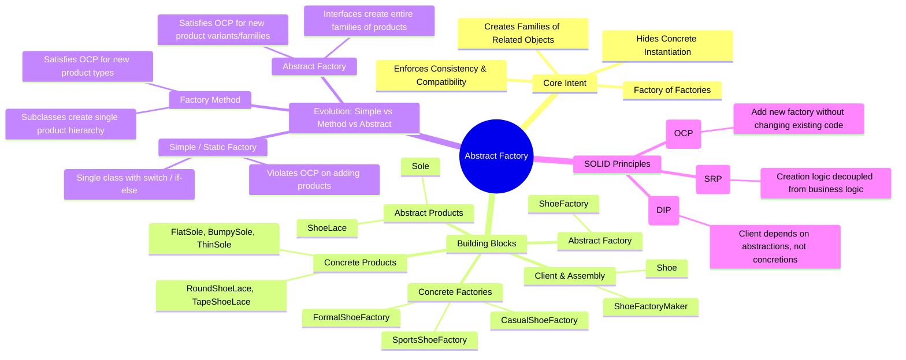
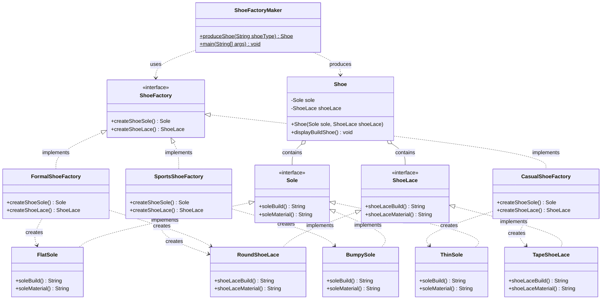

# Abstract Factory Design Pattern — Complete Guide & Master Revision Sheet

---

## 1. Visual Mind Map



---

## 2. Complete UML Class Diagram (Shoe Application)



---

## 3. The Big Why: Factory Evolution & Comparison

### The 3 Stages of Factory Patterns

| Dimension | 1. Simple / Static Factory | 2. Factory Method | 3. Abstract Factory |
| :--- | :--- | :--- | :--- |
| **GoF Pattern?** | No (Idiom / Programming technique) | **Yes** (Creational) | **Yes** (Creational) |
| **Primary Goal** | Centralize object instantiation in one method | Delegate creation of a **single product** to subclasses | Create **families of related or dependent products** |
| **Mechanism** | `static` method with `switch` / `if-else` | Inheritance & Polymorphism (virtual method) | Object Composition (factory interface with multiple creation methods) |
| **Product Hierarchies** | 1 product hierarchy | 1 product hierarchy | **Multiple** related product hierarchies (e.g. Sole + Lace) |
| **OCP Compliance** | ❌ **Violates OCP** (must modify switch case) | ✅ **Satisfies OCP** (add new subclass without modifying existing) | ✅ **Satisfies OCP** for new product families |
| **Example in repo** | Static notification/subscription factory | `NotificationSender` $\rightarrow$ `EmailSender` / `SMSSender` | `ShoeFactory` $\rightarrow$ `Sole` + `ShoeLace` |

---

## 4. Deep-Dive: Why Use Factory Method & Abstract Factory Over Simple Factory?

### A. The Flaw of Simple Factory (Static Factory)
In a Simple Factory:
```java
public class NotificationFactory {
    public static Notification createNotification(String type) {
        switch(type) {
            case "EMAIL": return new EmailNotification();
            case "SMS":   return new SMSNotification();
            // ⚠️ Adding PUSH requires opening and editing this file!
        }
    }
}
```
- **Violation of Open/Closed Principle (OCP):** Software entities should be *open for extension, but closed for modification*.
- Every time a new product type is introduced (`PushNotification`, `WhatsAppNotification`), you **must modify** the central factory class and risk introducing regressions or merge conflicts.
- High coupling to concrete classes in one single location.

### B. How Factory Method Solves It
- Defines an interface/abstract creator: `NotificationSender` with abstract `createNotification()`.
- Adding `PushNotification`:
  1. Write `PushNotification implements Notification`.
  2. Write `PushSender extends NotificationSender`.
- **Zero edits to existing classes!** The existing code is closed for modification, but the system is open for extension.

### C. Where Factory Method Falls Short & Why Abstract Factory is Needed
What if your product is not a single standalone item, but a **coordinated suite of related components**?
- A `FormalShoe` requires a `FlatSole` **AND** a `RoundShoeLace`.
- A `SportsShoe` requires a `BumpySole` **AND** a `RoundShoeLace`.
- A `CasualShoe` requires a `ThinSole` **AND** a `TapeShoeLace`.

If you used individual Factory Methods:
- The client could accidentally pair a `BumpySole` (sports) with a `TapeShoeLace` (casual) on a formal shoe!
- There is **no guarantee of product family consistency**.

**Abstract Factory guarantees consistency:**
- Each concrete factory (`FormalShoeFactory`, `SportsShoeFactory`, `CasualShoeFactory`) produces the **entire compatible family** of products together.
- The client code (`ShoeFactoryMaker` / `Shoe`) never knows which concrete sole or lace class is instantiated—it only interacts through `Sole` and `ShoeLace` interfaces.

---

## 5. Architectural Roles in Your Codebase

| Component | Code Entity | Responsibility |
| :--- | :--- | :--- |
| **Abstract Factory** | [`ShoeFactory.java`](./FactoryCode/ShoeFactory.java) | Declares creation contract for each abstract product family (`createShoeSole()`, `createShoeLace()`). |
| **Concrete Factory 1** | [`FormalShoeFactory.java`](./FactoryCode/FormalShoeFactory.java) | Produces formal family: `FlatSole` + `RoundShoeLace`. |
| **Concrete Factory 2** | [`SportsShoeFactory.java`](./FactoryCode/SportsShoeFactory.java) | Produces sports family: `BumpySole` + `RoundShoeLace`. |
| **Concrete Factory 3** | [`CasualShoeFactory.java`](./FactoryCode/CasualShoeFactory.java) | Produces casual family: `ThinSole` + `TapeShoeLace`. |
| **Abstract Product A** | [`Sole.java`](./Sole/Sole.java) | Declares interface for shoe soles (`soleBuild()`, `soleMaterial()`). |
| **Concrete Products A** | [`FlatSole.java`](./Sole/FlatSole.java), [`BumpySole.java`](./Sole/BumpySole.java), [`ThinSole.java`](./Sole/ThinSole.java) | Specific sole implementations. |
| **Abstract Product B** | [`ShoeLace.java`](./ShoeLace/ShoeLace.java) | Declares interface for shoe laces (`shoeLaceBuild()`, `shoeLaceMaterial()`). |
| **Concrete Products B** | [`RoundShoeLace.java`](./ShoeLace/RoundShoeLace.java), [`TapeShoeLace.java`](./ShoeLace/TapeShoeLace.java) | Specific shoe lace implementations. |
| **Client / Assembly** | [`Shoe.java`](./Shoe.java) & [`ShoeFactoryMaker.java`](./ShoeFactoryMaker.java) | Consumes abstract interfaces to construct and display the final shoe. |

---

## 6. Pros and Cons of Abstract Factory

### Advantages:
1. **Product Family Consistency:** Guarantees matching products are always used together.
2. **Strict Decoupling:** Client is completely isolated from concrete product classes.
3. **Single Responsibility Principle (SRP):** Product creation code is isolated in dedicated factory classes.
4. **Open/Closed Principle (OCP) for Families:** Adding a new family (e.g. `PartyShoeFactory`) requires zero modifications to existing factories.

### Disadvantages / Trade-offs:
1. **Hard to Add New Product Types:** If you want to add a third component (e.g., `Insole` or `ShoeTongue`), you have to update the `ShoeFactory` interface and **every single concrete factory** class.
2. **Higher Boilerplate:** Requires many interfaces and classes compared to a simple factory.

---

## 7. Top Interview Questions & Crisp Answers

### Q1: What is the primary difference between Factory Method and Abstract Factory?
> **Answer:** **Factory Method** produces a *single product* using inheritance (one factory method per creator class). **Abstract Factory** produces a *family of related or dependent products* using object composition (one factory interface with multiple factory methods).

### Q2: How does Abstract Factory enforce the Open/Closed Principle?
> **Answer:** It allows adding **new families of products** (e.g., adding `RunningShoeFactory`) by simply creating a new factory class implementing the interface, without altering any existing factory or client code.

### Q3: What is the major weakness of Abstract Factory?
> **Answer:** It is difficult to extend the factory to produce **new kinds of products**. Adding a new abstract product (e.g., `Insole`) breaks the `ShoeFactory` interface, forcing changes in every concrete factory subclass.

### Q4: When should you pick Abstract Factory over Builder?
> **Answer:** Use **Abstract Factory** when you need to create families of related products that must match and be created in a single step. Use **Builder** when an object requires a complex, multi-step construction process with many optional configurations.
